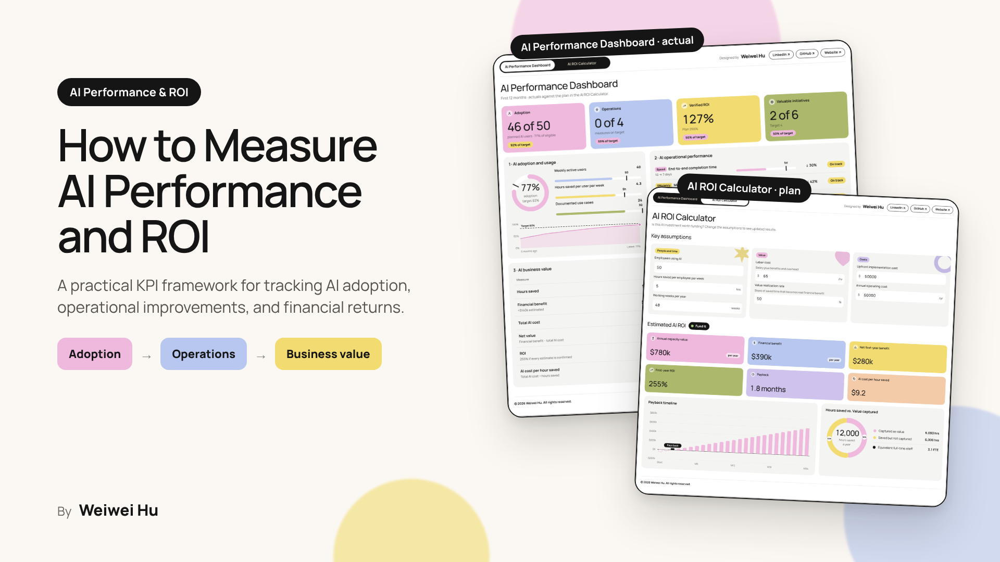

# AI Performance and ROI

**Mockup:** https://wei-wei-hu.github.io/ai-performance-roi/

Two executive tools in one page, built on a three-level framework for measuring AI:
AI adoption and usage → AI operational performance → AI business value.

- **AI Performance Dashboard** shows actual results against plan: adoption, operational KPIs (speed, efficiency, quality, decisions) and verified versus estimated business value.
- **AI ROI Calculator** estimates first-year value before you invest: annual capacity value, financial benefit, net benefit, ROI, payback and AI cost per hour saved.

**Note:** The AI Performance Dashboard is a mockup using illustrative data to demonstrate how AI performance can be tracked against plan. It does not capture any actual performance results.

## How AI ROI is calculated

1. Annual AI capacity value = employees × hours saved per week × working weeks × labor cost
2. Financial benefit = capacity value × value realization rate
3. Net first-year benefit = financial benefit − (upfront cost + annual operating cost)
4. First-year ROI = net benefit ÷ total first-year cost
5. Payback (months) = upfront cost ÷ ((financial benefit − annual operating cost) ÷ 12)

Figures are illustrative estimates for discussion only, not financial, legal or investment advice.

## Author

Designed by **Weiwei Hu** · [LinkedIn](https://www.linkedin.com/in/weiweihu) · [Website](https://weiweihu.carrd.co/)

© 2026 Weiwei Hu. All rights reserved. See [LICENSE](LICENSE).
